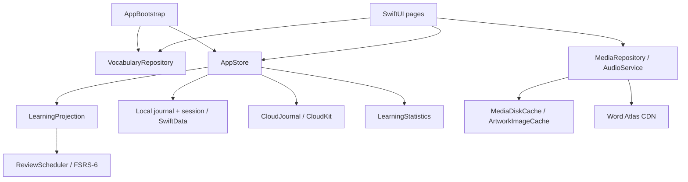

# 词屿 · Lexisle：代码结构与维护边界

这是一个共享业务实现的原生 iOS/macOS 应用。SwiftUI 负责呈现，SwiftData 保存用户状态，完整词库作为只读资源随包分发。界面不直接读写数据库或下载媒体。

## 目录与职责

| 目录 | 职责 | 修改入口 |
| --- | --- | --- |
| `App/Support` | 品牌与配置解析、应用启动、资源生命周期 | `AppBrand`、`AppConfiguration`、`AppBootstrap`、`NotificationObservation` |
| `App/Core` | 词库模型、索引解码、学习规则与 FSRS | `VocabularyRepository`、`AtlasIndex`、`SessionBuilder`、`ReviewScheduler` |
| `App/Persistence` | 会话事务、学习日志、云端传输及统计投影 | `AppStore`、`CloudJournal`、`LearningProjection`、`LearningStatistics` |
| `App/Media` | CDN 请求、文件缓存、图片解码、发音 | `MediaRepository`、`MediaDiskCache`、`ArtworkImageCache`、`AudioService` |
| `App/UI` | 页面、导航、设计组件 | 每个独立页面或组件拥有自己的文件 |
| `Config` | 本地与 CloudKit 构建配置 | `.xcconfig`、Info.plist、entitlements |
| `Scripts` | 可重复生成工程及导入内容 | `generate_project.py`、`import_resources.py` |

`WordAtlasApp` 只组装场景和平台能力。`AppBootstrap` 为整个应用提供一份词库和学习数据；每个窗口独立持有 `AppRouter`，避免窗口之间争用导航状态。

## 学习记录与事务

学习事件、收藏变更和设置变更都是带稳定 ID 的操作。`LearningProjection` 按时间与 ID 重放操作，生成当前设置、收藏、复习状态；`LearningStatistics` 按设备日历计算每日数量和连续学习天数。

本地提交依次完成以下步骤：

1. 读取当前日志，并验证新操作能否生成完整投影。
2. 在同一个 SwiftData 保存中写入操作和会话快照。
3. 保存成功后发布界面状态，再安排云端同步。

云端批量导入也先验证整批投影，再保存新增记录。不能依赖 `rollback()` 撤销已经成功的 `save()`；异常记录必须在保存前被拒绝。

云端入队和本地确认分属两个数据库，无法构成一个数据库事务。`CloudJournal.enqueue` 按操作 ID 去重，因此入队成功而本地确认失败时可以安全重试。只有真实的 CloudKit 传输事件才会更新“最近成功同步”时间。

## 并发与资源生命周期

- `AppStore`、启动器与可观察界面状态在 MainActor 上更新。
- 词库解码在后台执行；并发 `load()` 调用等待同一任务完成并发布数据，避免另一个窗口拿到空词库。
- `MediaRepository` actor 负责协调共享下载；磁盘校验和 LRU 淘汰由 `MediaDiskCache` 负责。
- 单个词卡取消加载不会取消其他词卡正在等待的相同下载；清理缓存会取消在途请求，并统一清理磁盘与图片内存缓存。
- `AudioService` 维护播放代次，旧请求不能接管新播放；可能阻塞的音频会话操作由串行后台队列执行。
- 通知令牌由 `NotificationObservation` 持有，拥有者释放时自动注销。

## 持久化兼容性

本次重构保留 `LocalSnapshot`、`LocalJournalEntry`、`CloudJournalEntry` 的类型名、字段、默认值及 V1 schema 标识。仅移动文件不会改变持久化格式。学习偏好的字符串值、日志 JSON 字段、旧会话缺失字段的默认解码，以及媒体缓存目录和文件名也保持兼容。

以后修改持久化模型时应新增版本化 Schema 和对应迁移；不能通过删除数据库或静默退回内存存储掩盖读取错误。更新词库时应保留词条 ID，并同时更新内容与媒体索引。

## 开发与验证

新增或移动 Swift 文件后运行 `python3 Scripts/generate_project.py`。生成器根据真实目录建立 Xcode 分组，重复生成的工程内容保持一致。不要只手改生成的 `.pbxproj`，以免下次生成丢失设置。

Swift 使用仓库根目录的 `.swift-format`：4 空格缩进、120 字符行宽、统一 import 与声明格式。格式检查只覆盖 `App`、`Tests` 和 `UITests`，不改写固定版本的第三方源码。

单元测试覆盖 FSRS 与原 TypeScript 实现的对照、旧会话解码、跨设备操作合并、重复提交、异常导入后的重新打开、夏令时日历统计、并发词库读取、缓存取消和下载重试。UI 测试使用内存数据，覆盖搜索、收藏、主题导航、学习与恢复。

构建和测试命令见根目录 README。CloudKit 的真实跨设备传输仍需开发者 Team、同一个 iCloud Container 及签名设备验证；本地日志合并测试不能代替这项验收。
