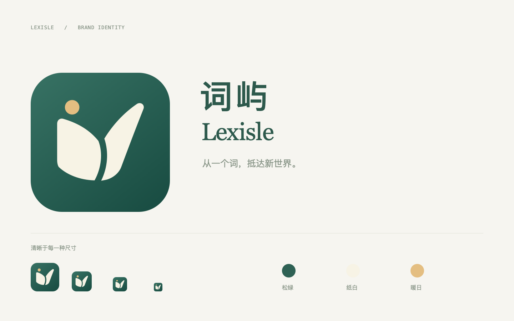
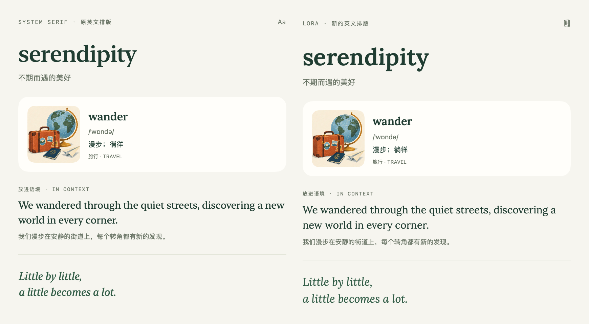

# 词屿 · Lexisle

**从一个词，抵达新世界。**

Lexisle 组合了表示词汇的 Lex- 与岛屿 Isle。标识把翻开的书页化成两片不对称的岛岸，中间的弧形留白既是书脊，也是海湾；暖色圆点代表日出。



## 品牌资产

| 文件 | 用途 |
| --- | --- |
| `lexisle-logo.svg` | 完整彩色 Logo，可无损缩放 |
| `lexisle-symbol.svg` | 透明背景的单色符号 |
| `lexisle-logo.png` | 1024 px 彩色展示图，带透明外角 |
| `brand-preview.png` | 名称、Logo、小尺寸与配色预览 |
| `../../App/Resources/Assets.xcassets/BrandMark.imageset/BrandMark.pdf` | 应用内矢量标识 |
| `../../App/Resources/Assets.xcassets/AppIcon.appiconset` | iOS 三种外观及 macOS 全尺寸图标 |

主色松绿 `#244F42`，纸白 `#F5F1DF`，暖日 `#DCB16E`。应用图标背景使用轻微的松绿渐变，深色和系统着色版保留相同轮廓。iOS 图标为无透明通道的方形母版，由系统裁切外形；macOS 图标带适当留边与圆角。

## 修改与生成

名称和标语统一配置在 `Config/Brand.xcconfig`，应用界面通过 `AppBrand` 读取。系统显示名称与运行时文字共用这些配置。

图形的矢量母版保存在 `Scripts/generate_icon.swift`。修改路径后运行：

```sh
xcrun swift -module-cache-path .build/IconModuleCache Scripts/generate_icon.swift "$PWD"
python3 Scripts/generate_project.py
```

同一组路径同时生成 PNG、PDF、SVG，避免桌面图标与应用内标识发生偏差。源码工程和模块继续使用 `WordAtlas` 这一技术标识，构建产物为 `Lexisle.app`；数据及媒体来源仍按原许可署名 Word Atlas contributors。


## 英文排版

学习内容使用 **Lora**，以带有书写感的衬线呼应温暖插画。单词标题使用 SemiBold，英文释义、例句、搭配与词族使用 Regular，侧栏寄语使用真正的 Italic 字重。中文、音标、界面操作及等级标签保留系统字体。

所有英文字体样式集中在 `App/UI/DesignSystem.swift` 的 `AtlasTypography` 中。词卡与正文分别设置 iOS、macOS 基础字号；使用 SwiftUI `relativeTo` 缩放，避免与 `@ScaledMetric` 叠加。字体通过 iOS `UIAppFonts` 和 macOS `ATSApplicationFontsPath` 加载，全部离线可用。



字体来自 [Lora 原作者仓库](https://github.com/cyrealtype/Lora-Cyrillic/tree/2d53b449b60e185b39f671b44fded83e0910ad30/fonts/ttf)，固定提交 `2d53b449b60e185b39f671b44fded83e0910ad30`。三个静态 TTF 均原样内置，总计约 610 KiB，采用 SIL Open Font License 1.1；完整许可为 `App/Resources/LORA_LICENSE.txt`，应用「内容与许可」页面也可查看。

| 文件 | SHA-256 |
| --- | --- |
| `Lora-Regular.ttf` | `c72a925082ba55885e7b4ead25d34a3c91fa44edda72a16a3a2983fc7fa7cef3` |
| `Lora-SemiBold.ttf` | `a9f5bbcebb6b53d53b6d7d571b2076f3db4931026693397200f69801b6701a81` |
| `Lora-Italic.ttf` | `1985f2fa49d675c3d88ca6a0b9161be38f955bec7efb025d2a5b68bc03e471fe` |
